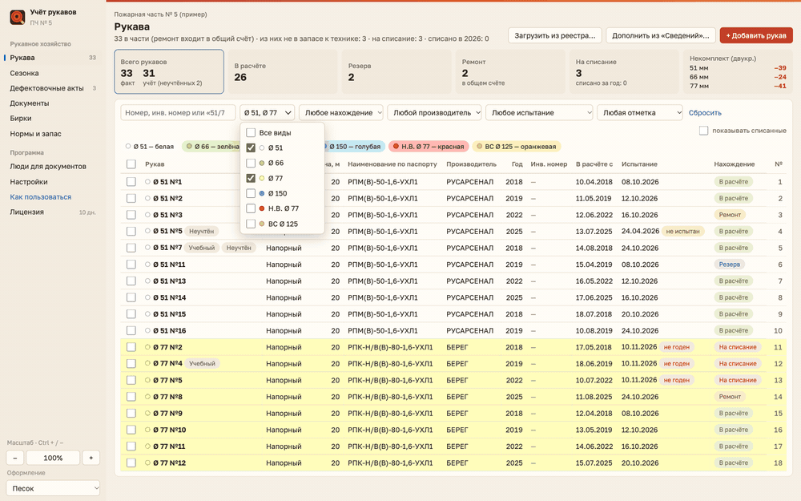
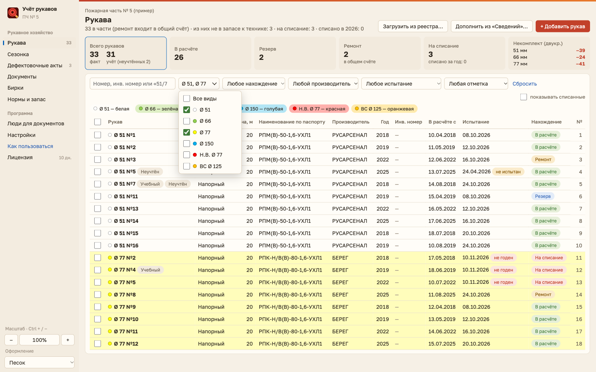
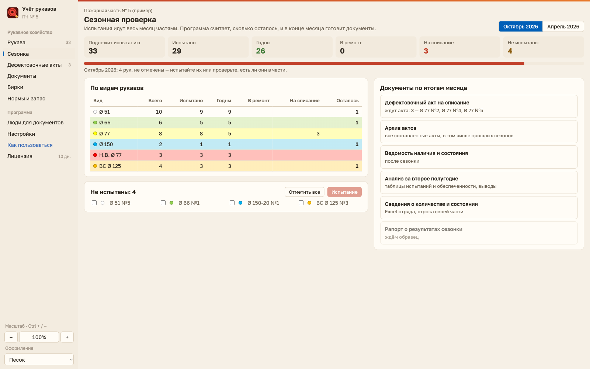
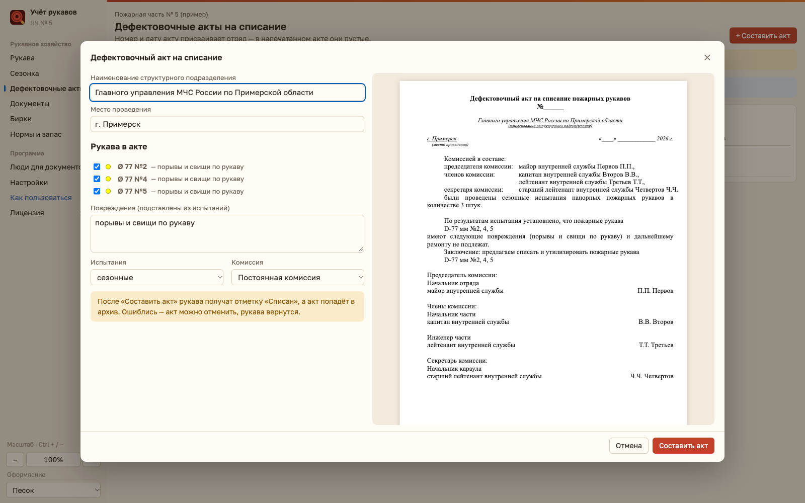
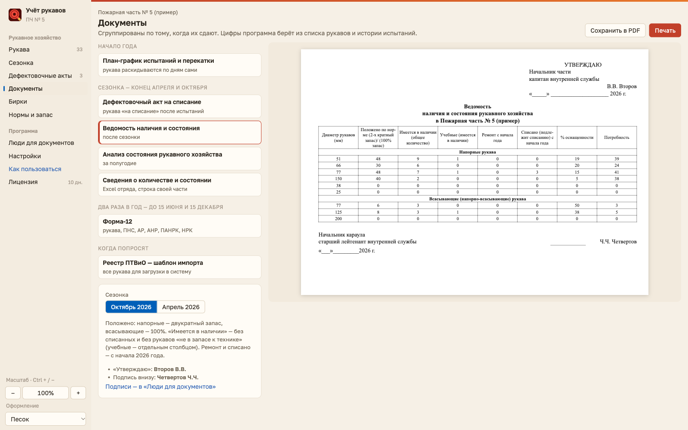
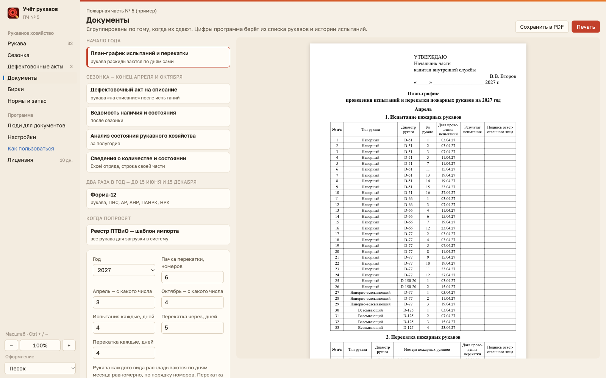
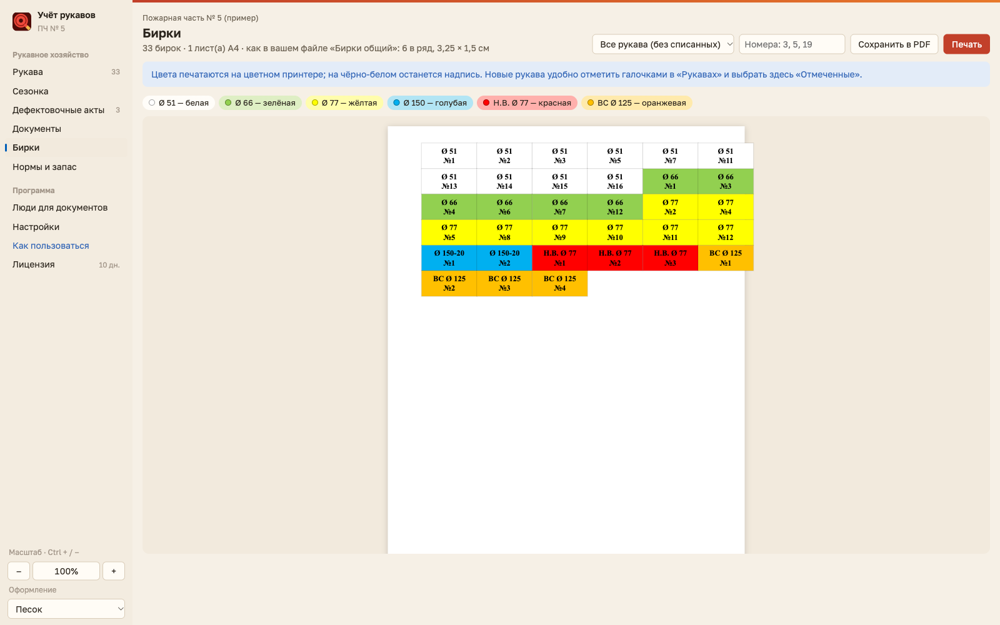
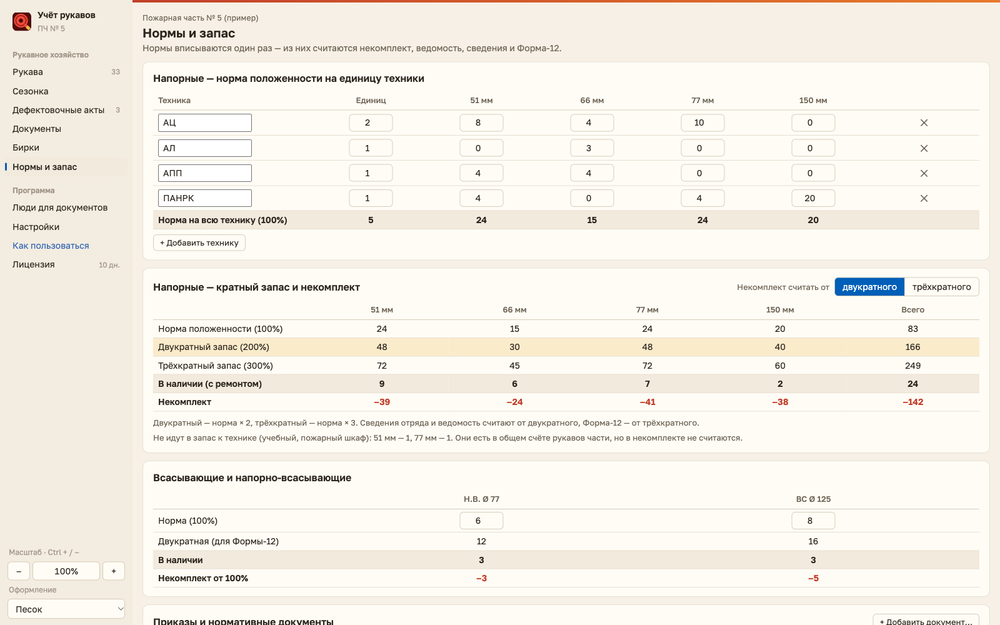
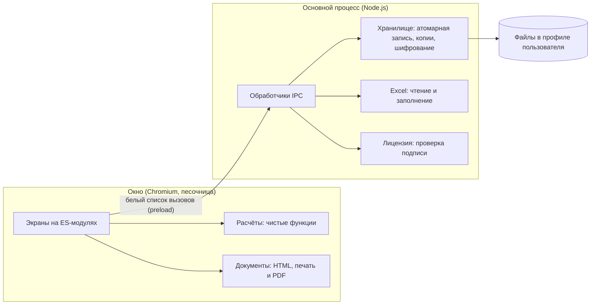

# Учёт рукавов

Настольная программа для учёта пожарных рукавов в подразделении. Заменяет ручное ведение таблиц: один общий список рукавов, а акты, ведомости, план-график, бирки и отчёты в формате вышестоящей организации собираются из него автоматически.

Программой уже пользуются на работе, она работает без интернета. Это коммерческий продукт, поэтому здесь опубликованы описание, скриншоты на вымышленных данных, архитектура и настоящие модули расчётов с тестами. Полный код находится в закрытом репозитории, доступ к нему могу открыть по запросу.

*A Windows desktop app (Electron) for tracking fire hoses: testing seasons, write-off acts, printable reports and filling official Excel forms. This repository is a showcase: description, screenshots with fictional data and the tested calculation modules. Full source is private and available on request.*



## Что умеет

- **Общий список рукавов:** поиск, фильтры (в том числе несколько диаметров сразу), сортировка, цвет строки по виду рукава, карточка с историей, счётчик «факт / учёт».
- **Сезонные испытания:** что подлежит испытанию, что осталось, годные, ремонт и списание по видам.
- **Дефектовочные акты:** собираются из забракованных рукавов, хранятся бессрочно, могут быть отменены, но не удалены.
- **Документы:** ведомость наличия, анализ за полугодие, план-график на год, бирки на лист А4, формуляры. Печать и PDF.
- **Формы вышестоящей организации:** программа заполняет присланный Excel-файл, не трогая формулы, чужие строки и оформление.
- **Загрузка данных:** реестр и сведения из Excel, с предпросмотром, поиском повторов и опечаток.
- **Нормы и запас:** норма положенности на технику, двукратный и трёхкратный запас, некомплект.
- **Работа без сети:** пароль на вход, автоблокировка, ежедневные копии, зашифрованная копия для переноса.
- **Лицензирование:** пробный период, затем режим просмотра, подписанная лицензия с привязкой к компьютерам.

| Рукава | Сезонка |
| --- | --- |
|  |  |
| **Дефектовочный акт** | **Ведомость** |
|  |  |
| **План-график** | **Бирки** |
|  |  |
| **Нормы и запас** | |
|  | |

## Устройство



**Стек:** Electron, JavaScript (ES-модули, без фреймворка), ExcelJS, JSZip, `node:test`, Playwright, electron-builder (установщик NSIS).

**Решения, о которых могу рассказать подробнее:**

- Расчёты отделены от интерфейса и не зависят от Electron, поэтому покрыты быстрыми тестами без запуска окна.
- Excel-файл организации заполняется правкой XML нужных ячеек: библиотеки при пересохранении портят формулы и оформление чужого файла. Кэш формул сбрасывается, итоги пересчитываются при открытии.
- Акт хранит снимок рукавов, комиссии и реквизитов, поэтому последующие изменения данных не меняют уже составленный документ.
- Лицензия подписывается Ed25519 в отдельной программе. В приложении лежит только открытый ключ, и работает всё без сервера.
- Запись базы атомарная, а её формат обновляется миграциями по номеру версии, поэтому новая версия ставится поверх старой с сохранением данных.
- Выпускаются две сборки из одного кода: на Electron 45 для Windows 10/11 и на Electron 22 для Windows 7/8. Сквозные проверки на Playwright проходят на обоих движках.

## Безопасность

Перед публикацией программа прошла проверку по коду. В ней работают такие меры:

- Окно изолировано: `contextIsolation`, `sandbox`, запрет Node.js, новых окон и переходов, строгая политика содержимого (CSP).
- Окно получает только перечисленные функции, а права проверяются в основном процессе.
- Пароль хранится как хеш scrypt со случайной солью, сравнение идёт за постоянное время.
- Копия для переноса шифруется AES-256-GCM, ключ получается из пароля через scrypt.
- Копия базы проверяется перед восстановлением, значения экранируются при выводе.
- Сборка защищена предохранителями Electron: код загружается только из `app.asar`, запуск как Node.js и отладка из командной строки отключены. В сборке для Windows 10/11 при запуске проверяется целостность файла программы.

Что нашла проверка и как закрыто:

| Проблема | Решение |
| --- | --- |
| Символы вроде `$'` в данных могли повредить заполняемый Excel | Подстановка функцией замены |
| Служебные поля чужой копии базы выводились без проверки | Проверка при восстановлении и экранирование при выводе |
| Короткий минимальный пароль | Не меньше 8 символов |
| Устаревшая версия Electron | Обновление до актуальной версии ветки |

Известные ограничения: база на диске пока не зашифрована, пароль защищает вход в программу. Установщик не подписан, поэтому защита сборки усложняет взлом, но полностью его не исключает. Сборка для Windows 7/8 работает на Electron 22, который больше не обновляется.

## Запуск тестов

В репозитории есть модули учёта, актов, отчётов и плана-графика (`src/`) и их тесты. Зависимости не нужны, достаточно Node.js 20 или новее:

```bash
npm test
```

## Лицензия

Все права защищены, см. [LICENSE](LICENSE). Материалы опубликованы только для ознакомления.
